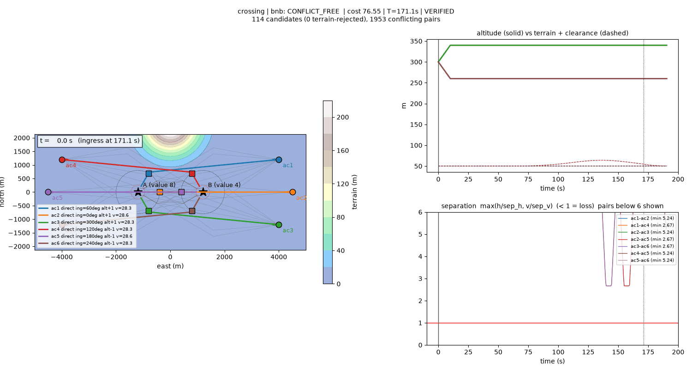

# traj-opt

Python prototype for **synchronized multi-aircraft ingress with joint deconfliction**.

Every aircraft must reach its target's ingress ring at the same time `T`. The plan must keep pairwise separation and terrain clearance, and stay inside speed, turn-radius, and climb limits. This repo replaces greedy prioritized planning (one aircraft at a time, first conflict-free candidate wins) with a small **joint selection**: generate candidates per aircraft, build a voxel conflict graph, then solve with branch-and-bound. An independent continuous-time verifier checks the result.



## Quick start

```bash
uv sync
uv run traj-opt run scenarios/crossing.json --solver both          # interactive window with time slider
uv run traj-opt run --seed 16 --solver bnb --png out.png --no-show  # random scenario, still image
uv run traj-opt run scenarios/crossing.json --gif out.gif --no-show
uv run traj-opt bench --seeds 200 --mc 100                         # greedy vs bnb + Monte Carlo robustness
uv run traj-opt gen my.json --seed 3                               # write a scenario to edit by hand
uv run pytest
```

| scenario | what it shows | greedy | bnb |
|---|---|---|---|
| `crossing` | two 3-ship flights pass head-on through the same midfield | NO_SAFE_PLAN | solved (altitude layers + approach sectors) |
| `greedy_fails` | first-fit picks for high-priority aircraft block later ones | NO_SAFE_PLAN | solved (bulges + alternate ingress) |
| `terrain` | hills block the direct corridors at the start altitude | NO_SAFE_PLAN | solved (terrain-aware cruise floor) |
| `sync_padding` | a close-in aircraft must add about 2 km of path to arrive on time | solved | same plan |

## Pipeline

```
scenario ─► common ingress time T ─► candidates per aircraft ─► terrain filter ─► voxel conflict graph ─► select ─► verify ─► Monte Carlo ─► viz
```

1. **Ingress time.** `T = max_i(shortest Dubins length_i / v_hi_i) + margin`. The slowest-to-arrive aircraft sets `T`, and everyone else stretches to match it. Speeds are planned inside `[v_min + m, v_max − m]` with `m = 15% × (v_max − v_min)`. That leaves each aircraft room to speed up or slow down to absorb wind and delays (fixes the "zigzag at exactly v_min" issue).
2. **Candidates** (`candidates.py`). Each candidate combines:
   - **ingress option**: 30° steps on an 800 m ring, best 4 by Dubins length. Points in the same direction are 45° apart.
   - **geometry**:
     - `direct` Dubins, when it fits the speed band.
     - `bulge_L/R`: Dubins through a lateral waypoint. The offset is bisected so the length gives nominal speed. This is the turn-radius-aware replacement for the triangle-wave zigzag.
     - `loiter_L/R`: whole orbits, then Dubins.
   - **altitude layer**: −1, 0, or +1 × 40 m above a terrain-aware cruise floor `max(z_start, max terrain along track + clearance + margin)`. Climbs are limited to 0.8 × the climb rate.

   Every candidate also has a straight terminal leg from the ingress point to `r_exempt`; convergence closer in than that is intended. Cost is value-weighted: geometry penalty + layer + ingress rank + extra length + deviation from nominal speed.
3. **Voxels** (`voxels.py`). Trajectories are rasterized into `(x, y, z, t)` cells (25 m × 10 m × 1 s), then inflated by `sep/2 + nav uncertainty` and `timing jitter`. Two candidates conflict when their inflated sets intersect, as in the production `SweptVolumeRasterizer`. Terrain is a conservative static layer. Same-target approach-sector conflicts and ingress-point spacing conflicts are added as extra edges. Lookups use an inverted index (sorted keys + bitmask), not all-pairs intersection.
4. **Select** (`select.py`).
   - `greedy`: the production behaviour. Fixed priority order (target value), first-fit, `NO_SAFE_PLAN` if anyone is blocked.
   - `bnb`: joint optimum over one candidate per aircraft, or *drop* at cost `drop_cost × value`. Depth-first search:
     - branches on the most-constrained aircraft first, cheapest candidates first;
     - admissible bound: cost so far + each remaining aircraft's cheapest unblocked option;
     - incumbent seeded with greedy-with-drops, so it is never worse than greedy;
     - stops at a node limit.

     A plan that drops aircraft is reported as `PARTIAL`, never silently.
5. **Verify** (`verify.py`). Shares no code with the voxels. Checks sync time, start state, speed band, climb rate, turn radius (circumradius), exact terrain clearance, altitude bounds, approach sectors, and pairwise separation `max(h/sep_h, v/sep_v) ≥ 1` on a 0.1 s grid. It runs on every plan.
6. **Monte Carlo robustness** (`robust.py`, `run --mc N`, default 200). This replays the chosen plan under execution errors:
   - per aircraft: wind (ground-speed bias, σ 1 m/s), start-time error (σ 3 s), cross-track offset (σ 10 m), altitude offset (σ 5 m);
   - each aircraft tracks its planned schedule with a proportional speed controller, limited to `[v_min, v_max]`.

   It reports the probability of separation loss, terrain clearance violation, and missing the ingress time by more than 2 s, plus tail percentiles and the worst pair.
7. **Viz** (`viz.py`). The map shows terrain, all candidates (faint), and the chosen paths with live positions and separation discs. Side panels show altitude vs terrain + clearance and separation ratio vs time. There is a time slider and GIF export.

## Results (`traj-opt bench --seeds 200`, 2 targets × 3 aircraft, 6 random hills)

```
greedy  all aircraft planned : 128/200
bnb     all aircraft planned : 190/200   partial (some dropped): 10
bnb rescued greedy failures  : 62
bnb cheaper than greedy      : 57/128  mean cost reduction 3.6%
bnb worse than greedy (bug)  : []
verifier failures (bug)      : []
build time mean 3.17s, bnb solve max 540ms, nodes max 114232
robustness of bnb plans (190 plans x 100 trials, mean over plans):
  p_sep_loss      mean   0.0%   plans with any: 1
  p_terrain       mean   0.0%   plans with any: 0
  p_arrival_miss  mean   1.4%   plans with any: 156
  arrival_err_p95 median 1.4s, min_sep_p05 median 4.71
```

Runtime is dominated by candidate generation and rasterization (about 2–3 s, pure numpy). Selection takes milliseconds. Partial plans are proven optimal (node limit not reached). In each, one aircraft's few remaining candidates all conflict with better uses of the airspace, so it is dropped. The fix for these cases is more candidate diversity (see simplifications), not more search.

**Robustness findings** (same 200 seeds, 100 trials per plan):

| config | all planned | P(arrival miss) | p95 \|arrival err\| | plans with any separation loss | build |
|---|---|---|---|---|---|
| old speed margin (0.5 m/s) | 192 | 18.9% | 5.4 s | 4 | 3.0 s |
| **15% speed margin** (current) | 190 | **1.4%** | **1.4 s** | 1 | 3.2 s |
| 15% margin + timing padding growing 1% of elapsed time | 190 | 1.4% | 1.4 s | 1 | 5.4 s |

- With the old 0.5 m/s margin, the aircraft that sets `T` hits `v_max` under a headwind or a late start and arrives late. The 15% margin costs 2 fully planned scenarios and removes most arrival misses.
- Timing padding that grows with time was tried and reverted. With schedule tracking, timing error is largest at the start (about 5.5 s p95, from the start delay) and settles to about 0.8 s within 30 s. So padding that grows over the flight is the wrong shape; it gave no benefit and was 1.7× slower to build. The fixed 1 s jitter matches the settled error.

## Tests

- `test_dubins.py`: endpoints, headings, length, curvature bound, chain continuity (random poses).
- `test_voxels.py`: head-on, crossing, time-separated crossing, parallel tracks, vertical layers, trailing within jitter, coarse-sampling guard, terrain. Also a **no-false-negatives property test**: every random pair that loses separation in continuous time must be flagged by the voxels.
- `test_select.py`: `bnb == brute_force` on 300 random instances; `bnb ≤ greedy` whenever greedy succeeds.
- `test_e2e.py`: plans from the full pipeline pass the verifier; determinism; JSON round trip.
- `test_robust.py`: zero dispersion reproduces the plan; determinism; the speed margin reduces arrival misses; large errors are detected as separation loss.

## Deliberate simplifications

- 2.5D kinematics: constant ground speed per candidate, Dubins in the horizontal plane, linear climb. No wind, no bank dynamics.
- One common `T` (no per-target slots) and a fixed candidate set (no column generation or space-time A* to add candidates when bnb drops someone).
- Synthetic Gaussian terrain. Headings use the math convention (0 = east, CCW); JSON uses `heading_deg`.
- Separation is checked only while both aircraft are airborne in the plan horizon (up to `r_exempt`).

## Caveats

How much the results prove:
- The greedy baseline uses this repo's candidate set. It is not production's `PrioritizedTrajectoryPlanner`, which also has timing exponents and sinusoidal reroutes. "Rescued" counts likely overstate the gain over production.
- The bench uses only this repo's generator with 2 targets × 3 aircraft. Scaling is untested; selection is exponential in the worst case, and each aircraft is capped at 64 candidates.
- Cost reductions are measured with hand-tuned cost weights.

Model gaps:
- The voxel check is conservative. No missed conflicts were found in testing, but the false-positive rate (safe plans rejected) is not measured.
- Separation is not checked within `r_exempt` (250 m) of the aimpoint.
- Planning assumes no wind, constant speed per candidate, turn radius independent of speed, and 1 s timing jitter. Wind and other errors appear only in the Monte Carlo check.
- The Monte Carlo error model (σ values, P speed controller, constant offsets) is assumed, not taken from flight data; results are only as good as these numbers. It ignores how wind changes the turn radius, and climb rate under speed changes.
- Early in the flight, timing error (up to about 5 s) exceeds the 1 s planning jitter. This is harmless here because aircraft are far apart early, but it is not guaranteed.
- `terrain_margin` (25 m) is a hand-tuned buffer for the conservatism of the voxel terrain check.

Coverage:
- Loiter geometries were never selected in the 200-seed bench; they are largely untested end to end.
- End-to-end tests cover 3 seeds.

## Where this maps back to autonomy-engine

| here | production |
|---|---|
| `candidates.bulge` | replace `ZigzagNode` triangle wave (turn-radius aware, exact length) |
| speed band margin | `TimedIngressPlanner` zigzag call planned at exactly `minSpeed` |
| `voxels.inflated_keys` | `SweptVolumeRasterizer` |
| `voxels.hits_terrain` | new static terrain layer in `VoxelReservationTable` |
| `select.bnb` | replace the first-fit loop in `PrioritizedTrajectoryPlanner`, then replay winners through `tryReserve` |
| `verify` | independent post-check before publishing |
